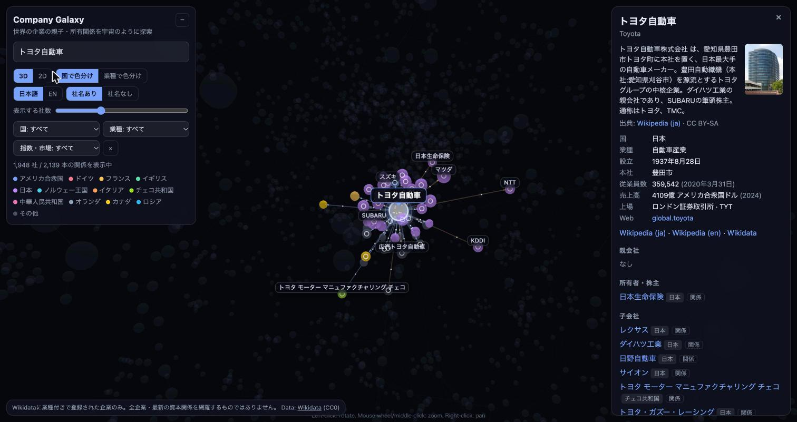
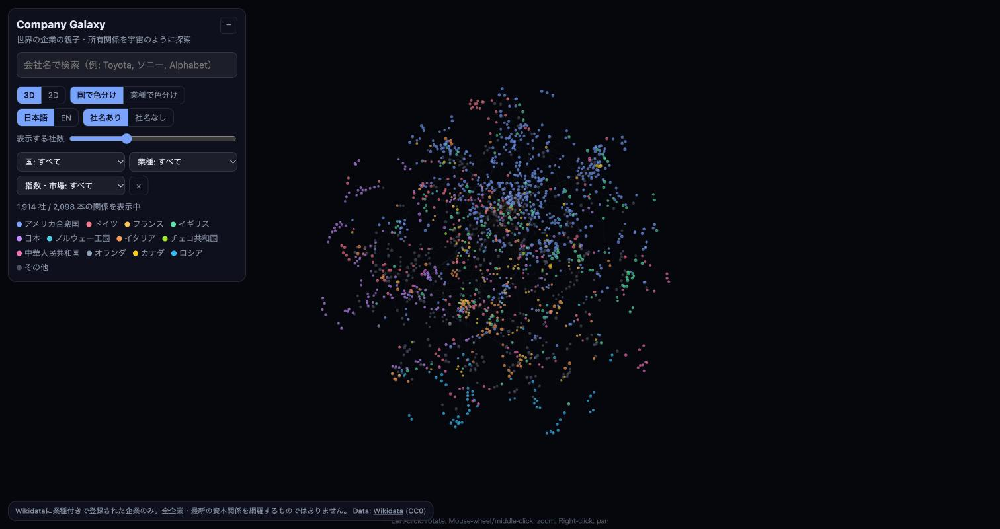

# Company Galaxy

Explore parent / subsidiary / ownership links between **24,013 companies** (21,815 links) in 3D or 2D.
世界の企業の親子・所有関係を、宇宙のように3D/2Dで探索できます。

**Live:** https://company-galaxy.vercel.app



| The whole galaxy, colored by country | |
|---|---|
|  | Search a company (Japanese or English), click it to light up its parents, owners and subsidiaries, and read its country, industry, employees, revenue and listing in the side panel. Filter by country, industry or stock index; switch 3D/2D, country/industry colors, Japanese/English names. |

- Data: [Wikidata](https://www.wikidata.org/) (CC0) — `P749` parent organization, `P355` subsidiary, `P127` owned by; companies = items with an industry (`P452`), minus schools/municipalities/etc. Descriptions in the panel come from Wikipedia (CC BY-SA, linked).
- Rendering: [3d-force-graph](https://github.com/vasturiano/3d-force-graph) / [force-graph](https://github.com/vasturiano/force-graph)
- Not every company, and Wikidata is not always up to date.

Rebuild data:
```
cd scripts
# download edges (see git history for the SPARQL), then
python3 fetch_nodes.py && python3 fill_labels.py && python3 build.py
```
